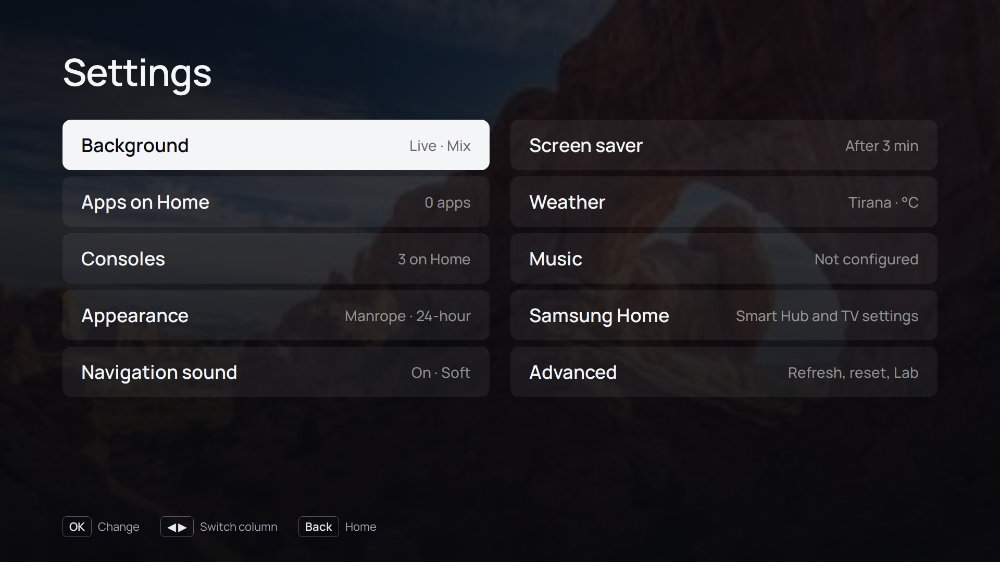
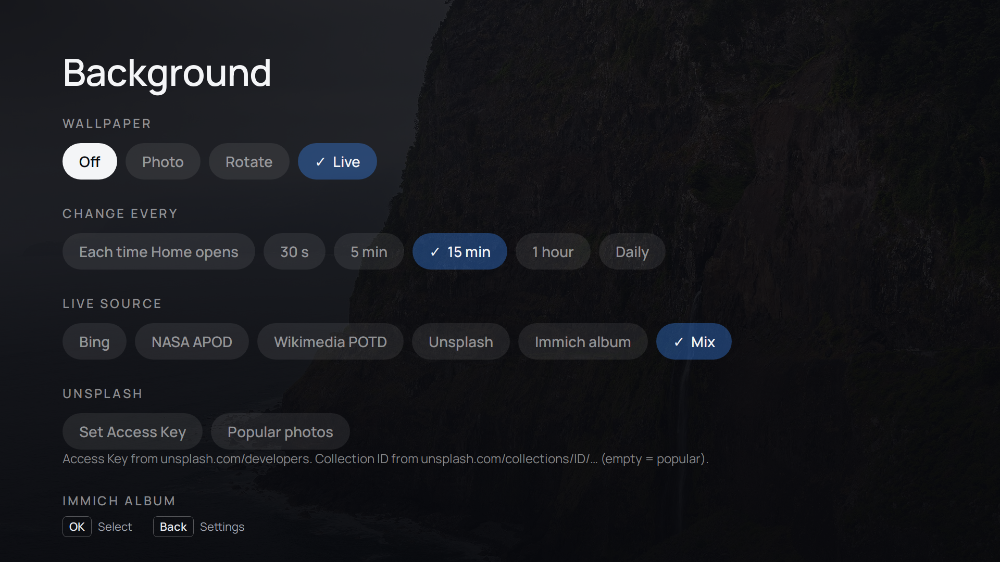
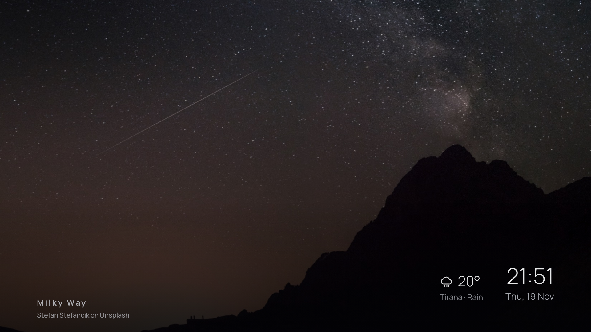

# Arn0+ — Immich / Mix / Navidrome

A quieter home screen for a Samsung Tizen TV: clock, your apps, your consoles — plus live photos
(Immich, Mix, and more), weather, and optional Navidrome music.

Fork of [NelsonEU/arn0-tv](https://github.com/NelsonEU/arn0-tv) by [NelsonEU](https://github.com/NelsonEU) — thank you.
TV label is **Arn0+**; app id stays `Arn0Lnchr0.Launcher` so Home / Vetro setup matches upstream.


| Settings | Live backgrounds | Screen saver |
| --- | --- | --- |
|  |  |  |

**Use at your own risk.** Making this the TV Home button changes undocumented settings. See
[docs/setup-tv.md](docs/setup-tv.md).

## What it does

- Home screen with clock, apps, and HDMI consoles (normal remote)
- Live wallpapers from the web or your own photos
- Weather on Home and on the screen saver
- Ambient music from Navidrome (or any Subsonic-compatible server)
- Screen saver with captions; **Right** skips to the next photo

This copy is installed with [Apps2Samsung](https://github.com/Apps2Samsung/Apps2Samsung) (thanks
[PatrickSt1991](https://github.com/PatrickSt1991)) and set as the TV Home screen with
[Vetro](https://github.com/andrearicci93/vetro) (thanks [andrearicci93](https://github.com/andrearicci93)).
You can also just open it from the app list.

## What’s added in this fork

- **Live backgrounds** — Bing, NASA APOD, Wikimedia Picture of the Day, Unsplash, Immich shared
  album, or **Mix** (all of those together)
- **Shuffle** — random order for Mix providers and for Immich / day-based photos
- **Immich** — your album on the TV; place/title captions fill in when ready
- **Screen saver** — landscape pan; portrait focus-zoom over a blurred background; remote next
- **Weather** — current conditions + 7-day strip (Open-Meteo); auto-detect location or search a city
- **Music** — Navidrome / OpenSubsonic / Subsonic play & next on Home and on the screen saver; random or playlist source
- Glass-style app tiles and a few Home polish details

## How to configure

Almost everything is in **Settings** on the TV (gear on Home):

| Setting | What to set |
| --- | --- |
| **Background** | Off / Photo / Rotate / **Live**. Pick provider (Bing, NASA, Wikimedia, Unsplash, Immich, Mix). Turn **Shuffle** on or off. Unsplash Access Key and Immich share link go here. |
| **Weather** | Location (detect / search) and °C / °F |
| **Music** | On/off, server, source (random or playlist), transport / volume |
| **Screen saver** | Delay, how often photos change, when to go dark |
| **Apps / Consoles** | What appears on Home, HDMI ports |
| **Appearance** | Clock, date, font, app name labels |

Optional seed before first run: copy `src/js/config.local.example.js` → `src/js/config.local.js`
(Immich link, Unsplash key, music server, weather). That file stays on your machine / in the
package and is not committed.

## Try it on a computer

Needs Node.js 20+.

```sh
git clone https://github.com/dx616b/arn0-tv.git
cd arn0-tv
npm run preview        # http://localhost:8080
```

Arrow keys + Enter; Esc = Back.

## Put it on a TV

1. Download **[Arn0Plus-0.6.14.wgt](https://github.com/dx616b/arn0-tv/releases/download/v0.6.14/Arn0Plus-0.6.14.wgt)**
   (or build yourself: `npm run build` → `dist/Arn0Plus.wgt`)
2. Install with [Apps2Samsung](https://github.com/Apps2Samsung/Apps2Samsung) → Custom WGT
   (it signs on install)
3. Optional: use [Vetro](https://github.com/andrearicci93/vetro) so Home opens this launcher

Details and recovery: [docs/setup-tv.md](docs/setup-tv.md).

Every push to `main` rebuilds a rolling prerelease; tag `v*` for a versioned release.

## Thanks

- [NelsonEU](https://github.com/NelsonEU) — original Arn0 launcher
- [PatrickSt1991](https://github.com/PatrickSt1991) / [Apps2Samsung](https://github.com/Apps2Samsung/Apps2Samsung) — easy sideload
- [andrearicci93](https://github.com/andrearicci93) / [Vetro](https://github.com/andrearicci93/vetro) — Home remapping

MIT — see [LICENSE](LICENSE). Not affiliated with Samsung, Immich, Navidrome, Apps2Samsung, or Vetro.
