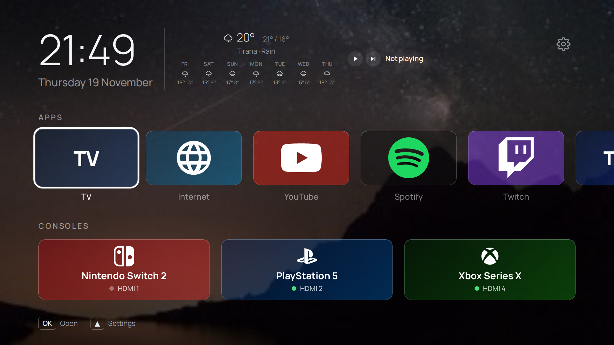

# Arn0 Launcher

A quieter home screen for a Samsung Tizen TV: a clock, a row of your apps, a row of your consoles,
and nothing else.



*The browser preview, with the bundled Manrope font and the "Milky Way" wallpaper.*

I built this for one TV in my living room, a Samsung Q70B on Tizen 6.5, because its own home
screen had become a shop. It does what I want: the apps I use, the consoles I own, driven by the normal remote. I am sharing it as a starting point rather than a product.

**Use it at your own risk.** The optional Home-button setup changes TV preferences that Samsung
does not document. See [the setup guide](docs/setup-tv.md) before using it.

## Recommended approach

I highly recommend forking it and building on top of it, ideally with a coding agent that can help
you understand and adapt the setup. Start with the browser preview, make the interface your own,
then work through TV installation when you're ready. Native Home/startup changes need particular
care; [the setup guide](docs/setup-tv.md) covers the risks and recovery steps.

## This fork

Built on [NelsonEU/arn0-tv](https://github.com/NelsonEU/arn0-tv) for one living-room TV. Still a
starting point, not a product — expect to fork and adapt.

On that TV this launcher is installed and kept as the **Home screen** with
[Vetro](https://github.com/andrearicci93/vetro) (sideload / remapping helper). That is optional:
the app also runs from the app list. Remapping Home depends on Vetro and undocumented TV
preferences — own-TV only, follow Vetro’s docs and [the setup guide](docs/setup-tv.md).

Extra behaviour on top of upstream:

- **Live backgrounds (multiple providers)** — Settings → Background → Live. Providers:
  **Bing**, **NASA APOD**, **Wikimedia Picture of the Day** (no keys), **Unsplash** (Access Key),
  **Immich** (shared album link), or **Mix** (all configured sources). Metadata only is cached;
  image bytes stay on the remote host. Unsplash / Immich are set in Settings (or seeded via
  `config.local.js`).
- **Upcoming plan + Shuffle** — Live keeps ~15 upcoming slots filled in the background (first
  photo shows as soon as one source answers). Mix round-robins providers, or picks at random when
  **Shuffle** is on; Shuffle also randomises Immich assets and day-based picks. Home stays
  responsive while the plan fills.
- **Immich captions** — search metadata first, then a full-asset polish for place/title; the
  screen saver refreshes the caption when polish lands.
- **Screen saver** — landscape photos cover + pan; portraits use contain over a blurred twin with
  a slow focus-zoom (can be cut mid-zoom when the photo changes). **Right** on the remote skips to
  the next photo; any other key closes. Clock stays minutes-only (seconds made the UI sluggish on
  this TV).
- **Home weather** — current conditions beside the clock (city · condition, temp with high/low),
  plus a strip of the next 7 days. Same Open-Meteo reading as the screen saver; place and unit in
  Settings → Weather.
- **Music (Navidrome / OpenSubsonic / Subsonic)** — ambient random playback in the launcher only,
  via the Subsonic API (works with [Navidrome](https://www.navidrome.org/) and other compatible
  servers). Credentials in Settings → Music (not in Advanced export). Compact play/next +
  now-playing beside weather on Home; title/artist also on the screen saver. Long labels scroll a
  few times then stop (avoids idle CPU from infinite marquee).
- **Glass tiles** — translucent brand fills so the wallpaper shows through on apps and consoles.
- **Native icons** — auto-crop transparent padding so sparse icons (e.g. Moonlight) fill the tile;
  optional `iconPad` override in `config.js` if needed.
- **Home polish** — Internet / Live TV brands, centered app and console labels, Live TV shown as
  **TV**, larger app icon, music chip without a solid panel behind it; Home wallpaper stays a
  light cover (no heavy blur) so the UI stays responsive.

Upstream Home-button / install docs still apply; this fork does not change that path.

## Try the interface

Needs Node.js 20 or newer. Nothing is installed and no TV is involved.

```sh
git clone https://github.com/dx616b/arn0-tv.git
cd arn0-tv
npm run preview        # http://localhost:8080
```

Navigate with the arrow keys and Enter; Esc or Backspace is Back; `R` `G` `Y` `B` are the remote's
colour keys. `#all` and `#lab` in the URL open those screens directly.

The preview runs against [`src/js/tizen-mock.js`](src/js/tizen-mock.js), a stand-in for the Tizen
APIs that is inert on the TV itself. So the layout, focus behaviour, settings, fonts and wallpapers
are all real, while launching apps and switching HDMI inputs only do something on a real TV.

## What you can change

Everything in [`src/js/config.js`](src/js/config.js) is meant to be edited: which apps appear, which
consoles and on which HDMI ports, how an input tile switches the TV, the locale, the starting
wallpaper. Most of it is also editable from the launcher's own Settings once it is on the TV, and
the TV's copy wins (`config.js` only supplies the defaults).

Beyond config: tile colours and brand marks in [`src/js/brands.js`](src/js/brands.js), the whole
look in [`src/css/style.css`](src/css/style.css), and your own photos as wallpapers.

Anything specific to your own TV — weather coordinates, a devlog address — belongs in
`src/js/config.local.js` instead. That file is gitignored and merged over `config.js` one level
deep, so the tracked file keeps its nulls while the local one reaches both the browser preview and
the packaged `.wgt`. Nothing to strip before a push, nothing to restore before a build. Copy
[`config.local.example.js`](src/js/config.local.example.js) to start.

## Coding agent prompt

This project was largely built with coding agents, and adapting it is a reasonable thing to hand to
one. A starting prompt that keeps the agent on the safe side of the line:

```
This is a Tizen TV launcher (see README.md). Work in the browser preview only.

Do: edit src/js/config.js, src/js/brands.js and src/css/style.css; run `npm run preview`
and check the result; keep the 1920x1080 stage and remote-only navigation intact.

Do not: connect to a TV, run sdb, sign or install a package, or touch anything
under native/. Do not change Home or startup behaviour.
```

TV work is different in kind: it needs a machine on the same network as the TV, so an agent that
can only read this repo cannot operate the TV. This repository includes the guarded helper source,
but does not include a ready-to-run SDB staging/runner script or a per-TV recovery snapshot.

## Put it on a TV

**[docs/setup-tv.md](docs/setup-tv.md)** — installing the package, then optionally the Home button
and power-on changes, with the recovery steps for each.

Installing the launcher is reversible by uninstalling it. The Home-button change is reversible
with the saved per-device baseline, but it rewrites undocumented platform preferences. The
launcher works fine without that change, open it from the app list like any other app.

Evidence and limits:

| | |
| --- | --- |
| Reference device | QE65Q70BATXXC (Q70B, 2022), firmware T-PTMDEUC-1720.7, Tizen 6.5, armv7 |
| Install | `.wgt` via Apps2Samsung or Tizen Studio CLI; works |
| Home button | Tested on the reference device: opens `Arn0Lnchr0.Launcher` |
| Power-on | `auto_start` was `1` and remains `1`; the helper does not change it. Cold-boot behaviour has not been independently validated as part of the Home-button change |
| Method | Developer Mode, UID 901, platform `vconf` / `aul` calls. **No root.** |
| Open items | Untested on `auto_start=0` TVs; behaviour after a firmware update unknown |
| Other models | **No compatibility claim.** The helpers check architecture, UID, and firmware string, but do not verify the TV model |

## Reference

### Commands

```sh
npm run preview      # browser preview on :8080
npm run build        # -> dist/arn0-launcher.wgt
npm run devlog       # receive Lab logs from the TV into logs/tv.jsonl
node scripts/prepare-wallpapers.mjs <folder>   # regenerate wallpapers from your photos
```

### Remote

| Key | Action |
| --- | --- |
| Arrows | move (Up from the apps row reaches the gear = Settings) |
| OK | open app / switch input / select |
| Back | one level back (does nothing on Home) |

Hidden shortcuts: Red = All apps, Green = next wallpaper, Yellow (in All apps) = show system apps,
Blue = Lab.

### Layout

```
src/                  everything that goes into the .wgt
  config.xml          Tizen manifest (app id, privileges)
  css/style.css       1920x1080 stage; performance rules measured, not assumed (see its header)
  fonts/              Manrope, Inter, Outfit, DM Sans (OFL), bundled so nothing loads from the network
  img/marks/          brand marks (Simple Icons CC0, Custom Brand Icons MIT; see SOURCES.md)
  img/tiles/          marks recoloured per brand (generated at build)
  img/wallpapers/     1920x1080 wallpapers with the readability scrim baked in (generated)
  js/config.js        your apps, consoles, HDMI method, locale, theme
  js/config.local.js  gitignored per-TV overrides, merged over config.js (not in the repo)
  js/brands.js        tile colours and marks per brand
  js/apps.js          list / filter / launch via tizen.application
  js/inputs.js        HDMI via tizen.systeminfo + tizen.tvwindow
  js/wallpaper.js     wallpaper display and rotation
  js/live-wallpaper.js  Live providers (Bing, NASA, Wikimedia, Unsplash, Immich, Mix) + plan
  js/screensaver.js   idle screen saver: photos, clock, weather, now-playing, remote next
  js/appearance.js    clock, date and font settings
  js/weather.js       Open-Meteo for Home and the screen saver
  js/subsonic.js      OpenSubsonic / Subsonic / Navidrome client (enc: auth)
  js/music.js         ambient random playback and now-playing UI
  js/prefs.js         settings saved on the TV
  js/ui.js            screens, focus, keys, toast, pop-up menu
  js/home.js          Home, All apps, Lab
  js/settings.js      Settings pages
  js/devlog.js        development log (Lab screen, optional upload to your computer)
  js/render-probe.js  measures what this TV can actually render (Lab screen only)
  js/platform-probe.js  reports which tizen.* / webapis.* APIs the TV exposes (Lab screen only)
  js/boot.js          start-up
  js/tizen-mock.js    fake Tizen APIs for the browser preview (inactive on the TV)
scripts/              build.sh, serve.mjs, devlog-server.mjs, fetch-assets.mjs, make-icon.mjs
native/               guarded Home/startup helpers — read docs/setup-tv.md first
docs/                 setup guide
```

### Settings

Saved on the TV in `localStorage`. They survive restarts and in-place updates, not an uninstall.

- **Background** — Off (plain gradient), one photo, rotate (on each Home, 30 s, 5 min, 15 min,
  1 hour, daily), or **Live** (Bing / NASA APOD / Wikimedia POTD / Unsplash / Immich album /
  Mix). Unsplash key and Immich share link in Settings; **Shuffle** for Rotate and Live.
- **Apps on Home** — OK on an app opens Move / Remove; OK on the right-hand slot adds one.
- **Consoles** — per console: rename (on-screen keyboard), HDMI port, logo, how it opens, hide,
  reorder, remove; plus add a console.
- **Appearance** — 24/12-hour clock, date shown/hidden, date language (English, Español, Français),
  font, app names (always / when selected / never).
- **Navigation sound** — turn arrow-key sounds on or off, choose Soft, Warm or Bright, and preview
  the selected tone.
- **Screen saver** — on or off, start after 3/5/10/15 min idle on Home, photo change every
  60/75/90 s while Background is on Rotate or Live, go dark after 30 min / 1 hour / 2 hours /
  never, and show it now. Right skips photo; other keys close.
- **Weather** — place (city list or off), °C / °F; feeds Home and the screen saver.
- **Music** — Navidrome / OpenSubsonic / Subsonic server, user, password, on/off, volume;
  play/next from Home.
- **Samsung Home** — opens `com.samsung.tv.csfs`, from which TV settings are one press away.
  Opening `com.samsung.tv.coba.setting` directly does not work on this TV. Keep this entry: it is
  the route back if you have redirected the Home button.
- **Advanced** — refresh the app list, export settings to the log, reset everything, Lab.
  Music credentials are stored separately and are not included in export.

### Wallpapers

Photos are cropped to 1920x1080 and darkened (top-left for the clock, bottom for the tiles) at
build time, so the TV only ever draws one plain JPEG on its own layer. Drop photos in a folder and
run `node scripts/prepare-wallpapers.mjs <folder>`; friendly names and crop positions for known
files live in that script. Current photos are from Unsplash; credits appear when you switch with
Green.

### Screen saver

After a few minutes with no input on Home it shows the wallpapers full screen with the clock, the
weather, optional now-playing, and the photo caption. **Right** skips to the next photo (Rotate /
Live); any other button closes it, and that press does nothing else. It never appears over a
console input or another screen.

Weather comes from [Open-Meteo](https://open-meteo.com/) (no API key). Pick a city in Settings →
Weather, or seed coordinates in `config.local.js`. The reading is cached in `localStorage` so Home
and the screen saver open with real numbers even after the TV has been off; it refreshes at most
once an hour and only when something is about to show it, and anything older than three hours is
treated as no reading at all.

Everything in it moves, because a clock parked in one corner for an hour is a burn-in risk:
landscape photos cover and pan; portraits sit over a blurred fill and focus-zoom slowly (a photo
change may cut the zoom mid-way). The clock moves to another corner every couple of minutes, and
the whole thing fades to black once the configured hour is up. Photos follow the **Background**
setting — Rotate / Live cycle them, a single photo is held, Off leaves just the clock — using the
screen saver's own position, so it never rewrites the wallpaper Home comes back to.

Black, rather than off, because a web app cannot turn this panel off: `tizen.power` and
`webapis.power` are both absent on the reference TV, which **Platform probe: what APIs this TV
exposes** in the Lab screen will confirm on yours. No privilege changes that — an absent API gives
you nothing to be refused by. A real power-off is the TV's own Eco Solution ▸ Auto Power Off,
driven by the same absence of remote input that started the screen saver.

Only `transform` and `opacity` animate, which the compositor can run without repainting. Not every
composited property is equal here, though, and only running it on the TV showed it: the first
version used a slow `scale()`, which this engine re-rasterises in visible steps rather than
compositing, and it stepped badly enough to be unpleasant to watch. A `translate()` of the same
layer is smooth, so the photo pans instead of zooming and the layer is laid out 320×180 larger
than the screen to give it room. The Lab probe cannot settle this one: it times a JavaScript
repaint loop, and a transition that runs off the main thread reads as a clean 60 fps there whether
or not the panel keeps up. Judge it by eye on the TV.

### Apps

`getAppsInfo` reports many internal services as visible, so **All apps** keeps only ids that look
like store apps (`AbCdEfGhIj.Name`, or numeric) plus a short list of preinstalled consumer apps, and
drops names containing service/worker/agent/e-manual. Yellow shows everything when you need to find
something. The id of the focused app is shown bottom-left — pin it in `config.js` as `{ id: '...' }`,
which is more reliable than a name match.

### HDMI inputs

`tizen.systeminfo.getPropertyValue('VIDEOSOURCE')` lists the ports and `tizen.tvwindow.setSource()`
changes the source (privilege `tv.window`, public). What happens next is undocumented, so
`inputMethod` has three options:

- `switch+viewer` (default) — set the source, then open Samsung's TV viewer, so the console is shown
  by the TV itself with Game Mode and friends as usual.
- `switch` — only set the source.
- `inapp` — show the input full screen inside the launcher; Back returns to the dashboard. Probably
  no automatic Game Mode or VRR this way.

The **Lab** screen (Blue) tries each method per console and reports what happened. The dot on each
tile is green when the TV reports that port as connected.

To collect Lab results on your computer, point `devLogUrl` in `config.js` at it and run
`npm run devlog`; entries land in `logs/tv.jsonl`. Set it to `null` to disable, which is the
sensible setting for a TV you are not actively debugging.

### What the hardware can afford

The TV will not tell you what it can render, so the Lab screen measures it. **Render probe:
everything** walks a focus ring along eight tiles — the same work as moving along the apps row —
and counts frames against the wall clock for each of four stages. Results land in the log.

On the reference Q70B (Chromium 85, 4 cores, 2 GB), baseline is 59.5 fps / 16.8 ms with no
dropped frames, and:

| | Measured | |
| --- | --- | --- |
| Blurred `box-shadow`, 8 tiles at `0 40px 100px` | 59.5 fps, 0 dropped | free |
| 3 live radial-gradient layers, 1100 px | 4.6 fps, 178.7 ms, 88/90 dropped | never at runtime |

So soft shadows are fine and background glows are not. Bake a gradient into the wallpaper at
build time instead — `scripts/prepare-wallpapers.mjs` already does exactly this for the
readability scrim.

The probe also reports the engine and its CSS support, which saves guessing: Chromium 85 has
grid, gap, sticky and `clamp()`, but no `inset`, `aspect-ratio`, `overflow: clip`, individual
transform properties, `color-mix()`, container queries or `:has()`.

Re-run it on your own TV before trusting any of these numbers; that is the whole point of it.
Two of my own early runs produced nonsense — `requestAnimationFrame` on this engine stops
tracking vsync and fires callbacks in batches, which reads as absurdly high frame rates, so the
probe now measures against `Date.now()` and flags any sample faster than the panel refreshes.

### Privileges

| Privilege | Used for |
| --- | --- |
| `application.launch` | opening apps and the TV viewer |
| `application.info` | listing apps |
| `tv.inputdevice` | colour keys (arrows, OK and Back need no registration) |
| `tv.window` | HDMI source switching and display |
| `internet` + `<access origin="*">` | Open-Meteo; Bing/NASA/Wikimedia/Unsplash/Immich live wallpapers; Subsonic/Navidrome streams; development log |

## Contribute

Forks and experiments are welcome. If you report a problem, include your model, firmware and what
you actually observed, and strip local addresses and device identifiers first.

What I would find most useful: results from other models and Tizen versions, and especially from a
TV where `db/menu/smart_hub/ontvsetting/auto_start` starts at `0`.

## Licence and credits

MIT for the original code and documentation — see [LICENSE](LICENSE). Bundled fonts (OFL), Unsplash
photos and brand marks keep their own terms. Live photos may also come from Bing, NASA APOD,
Wikimedia Commons, or your own Immich album — each keeps its own terms. Weather data by
[Open-Meteo](https://open-meteo.com/), used under its non-commercial licence. Music talks to
Navidrome / OpenSubsonic / Subsonic servers you configure. Brand names and logos belong to their
owners.

This project is independent and is not affiliated with Samsung, Immich, Navidrome, or any
streaming service.

The Home-button approach follows [CleanFrame](https://github.com/nthnclrk/CleanFrame), which
documented the method on a 2024 Frame. The guarded helpers here are an adaptation tested on the
Q70B and exact firmware listed above; that does not establish compatibility with other devices.
